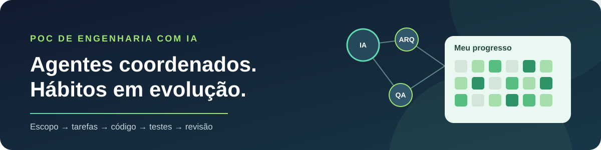
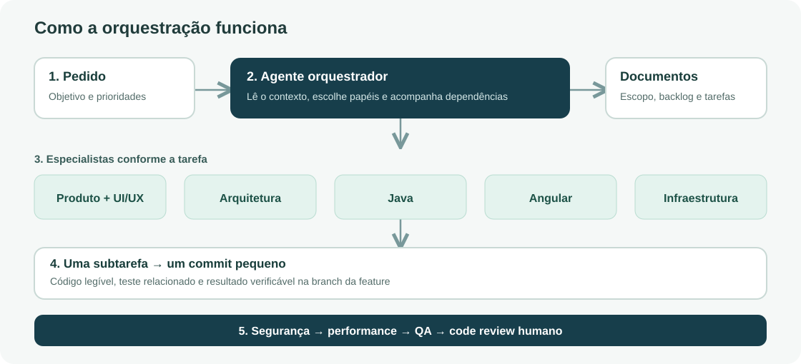

# Habit Tracker · POC de orquestração de agentes

> 🧪 Um experimento de desenvolvimento de software com agentes de IA coordenados, usando um tracker de hábitos como produto real para testar o processo.

## 🤖 O foco do projeto

O objetivo principal é **experimentar uma forma controlada de orquestrar agentes de IA para desenvolver uma aplicação**. O tracker de hábitos fornece requisitos concretos, decisões de arquitetura, interface, segurança e testes para avaliar essa abordagem.

O agente principal recebe o pedido, consulta os documentos do projeto, divide o trabalho em tarefas pequenas e aciona os especialistas necessários. Os arquivos em [`agentes/`](agentes/) descrevem papéis e critérios de trabalho; **são instruções Markdown, não programas que executam sozinhos**. A execução e a coordenação acontecem na sessão do agente de codificação.

### 🧠 Recursos e técnicas de IA

| Técnica | Aplicação neste projeto |
| --- | --- |
| **Contexto estruturado** | [`AGENTS.md`](AGENTS.md), [`ESCOPO.md`](ESCOPO.md), [`BACKLOG.md`](BACKLOG.md) e padrões técnicos dão ao agente requisitos e limites verificáveis. |
| **Papéis especializados** | Analista de produto, refinador de tarefas, arquiteto, UI/UX, Java, Angular, AWS, segurança, performance e QA possuem instruções próprias. |
| **Decomposição progressiva** | O escopo vira features, histórias e depois subtarefas pequenas; apenas o trabalho próximo é detalhado. |
| **Orquestração por dependências** | O agente principal escolhe os papéis necessários e evita edições concorrentes no mesmo arquivo. |
| **Revisão com evidências** | Segurança, performance e QA verificam código, testes e resultados; o usuário faz o code review antes da integração. |
| **Rastreabilidade no Git** | Uma branch por feature e um commit pequeno por subtarefa, identificado por `F-xx T-xxx`. |

A IA já auxilia o planejamento; seu uso na implementação e na revisão seguirá o mesmo fluxo quando o código existir. Decisões abertas permanecem registradas; o agente não deve inventar requisitos para concluir uma tarefa. O processo prioriza **segurança → performance → qualidade**.

## 🌱 O produto: tracker de hábitos

A primeira versão será uma **aplicação web responsiva**, com foco no uso pelo celular. Cada pessoa poderá organizar seus hábitos e acompanhar constância e volume de atividade. Um app mobile nativo fica para uma etapa futura.

- 🔐 **Conta:** entrada por link enviado ao e-mail ou por Google, sem senha local.
- 🎯 **Hábitos:** nome, cor, ícone opcional, categoria e unidade de medida (tempo, km ou execução simples).
- 📅 **Metas:** quantidade diária, quantidade em dias da semana escolhidos ou registro livre.
- ✍️ **Registros:** vários lançamentos por dia, com criação, correção e exclusão de dias anteriores.
- 🟩 **Calendário:** quadrados com intensidade definida pelo **número de registros no dia**; horas e km aparecem como totais separados.
- 📊 **Evolução:** cada hábito mostra se o total na sua unidade está abaixo, igual ou acima do mesmo período do mês anterior.
- 🎨 **Personalização:** temas claro, escuro, militar, feminino e neutro.
- 📤 **Compartilhamento:** imagem de um hábito ou resumo geral, gerada por ação do usuário para salvar ou compartilhar.

As regras completas, inclusive isolamento de dados entre usuários e tratamento do fuso do dispositivo, estão em [`ESCOPO.md`](ESCOPO.md). As entregas menores estão em [`BACKLOG.md`](BACKLOG.md).

## 🧰 Stack planejada

| Camada | Tecnologias |
| --- | --- |
| ☕ Backend | Java 17, Spring Boot 4.x, Spring Web MVC, Spring Security e Maven |
| 🗃️ Dados | PostgreSQL, Spring Data JPA e Flyway |
| 🅰️ Frontend | Angular 22, TypeScript, Angular Router e HttpClient |
| 🐳 Ambiente local | Docker Compose, PostgreSQL e Mailpit para capturar e-mails de teste |
| 🧪 Testes | JUnit Jupiter, Spring Boot Test, Testcontainers, JaCoCo, Vitest e Playwright |
| ☁️ Hospedagem futura | AWS, somente após a aplicação local funcionar e ser medida |

As versões exatas serão fixadas ao criar os módulos. Consulte [`PADROES_TECNICOS.md`](PADROES_TECNICOS.md) para decisões de arquitetura e práticas de código.

## 🛡️ Critérios de engenharia

- Segurança vem primeiro: autorização no servidor, proteção dos links de acesso e **nenhuma credencial real no repositório**. Veja [`SEGREDOS.md`](SEGREDOS.md).
- Código legível, POO e SOLID aplicados com propósito, contratos claros e mudanças pequenas para revisão humana.
- Cobertura mínima de **95% nas métricas definidas** para backend e frontend, além de testes integrados e jornadas web. Veja [`QUALIDADE_TESTES.md`](QUALIDADE_TESTES.md).
- Dívida técnica registrada com impacto e condição de correção em [`DIVIDA_TECNICA.md`](DIVIDA_TECNICA.md).
- Cada feature possui sua branch; cada subtarefa que altera arquivos possui seu commit. Veja [`VERSIONAMENTO.md`](VERSIONAMENTO.md).

## 🚧 Estado atual e execução

O repositório contém **escopo, backlog, tarefas, agentes e controles de qualidade**. O [`compose.yaml`](compose.yaml) já prepara PostgreSQL e Mailpit, conforme [`LOCAL_DOCKER.md`](LOCAL_DOCKER.md). A API Java e o frontend Angular ainda não foram implementados; portanto, o tracker completo ainda não pode ser executado. A implantação AWS fica para depois da validação local.

Para iniciar a implementação, siga a próxima tarefa pronta em [`TAREFAS.md`](TAREFAS.md), verifique sua dependência e trabalhe na branch da feature correspondente. O primeiro fluxo de produto planejado é o acesso por link de e-mail (`H-01`).
